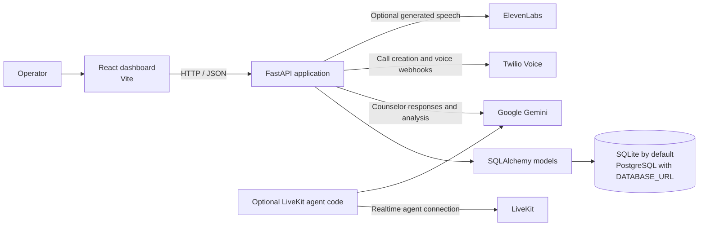

# AI Outbound Calling Platform

A full-stack student outreach and career-counseling application. It combines a React dashboard and FastAPI backend with lead and campaign management, a call queue, Twilio voice webhooks, and a Gemini-powered AI career counselor.

The repository contains both interactive dashboard pages and backend integrations. Some dashboard controls are simulations or summaries; see [Implementation notes](#implementation-notes) before treating the project as a production dialer.

## Overview

The platform is designed to help an education or training team organize prospective-student outreach and review its results. Operators can manage leads and campaigns, initiate or queue calls, review call records, schedule follow-ups, and use a career-counselor chat experience. When configured, the backend connects to Twilio for telephony, Gemini for counselor responses, and ElevenLabs for generated speech.

## Key features

- **AI outbound calling:** Backend endpoints can initiate calls through Twilio. Twilio voice webhooks collect speech, request counselor responses, and return TwiML for the next call turn.
- **Lead and CRM management:** Create, update, search, filter, import, export, and review lead records. Lead profiles include education, interests, career goals, status, call history, and follow-ups.
- **Do Not Call (DNC):** Leads can be marked as opted out. The call-initiation and queue paths check DNC status before dialing.
- **Campaigns:** Create and edit campaigns, associate leads, and launch, pause, or resume a campaign. Launching a campaign adds eligible leads to the call queue.
- **Call queue:** Review queue position and status, add or remove leads, retry an item, or request the next eligible queued call.
- **AI agents:** Manage agent profiles and their role, language, voice, greeting, objectives, and prompt fields. The backend ensures a primary Priya career-counselor agent exists.
- **Conversation intelligence:** Call records can include transcripts, summaries, intent, sentiment, topics, objections, and a suggested next action. Intelligence processing is available for calls with a transcript.
- **Knowledge base:** Upload PDF, TXT, or Markdown files for extraction and storage; manage FAQ records. Bundled course, FAQ, workshop, and counselor prompt files provide the counselor's configured context.
- **Follow-ups:** Schedule, edit, complete, cancel, and delete follow-up records for leads.
- **Analytics and reports:** View database-backed dashboard and analytics summaries, report on leads, calls, campaigns, and follow-ups, and export CSV reports.
- **Settings:** Review backend/database and AI/telephony configuration status. The settings endpoint masks the configured Twilio phone number and does not return API secrets.
- **AI Career Counselor:** Use the counselor chat route and dashboard experience to discuss career paths, courses, and student interests.

## Main modules

| Module | Purpose |
| --- | --- |
| Dashboard | Summary counts and outreach indicators |
| Leads and lead details | Lead CRM, imports/exports, DNC state, calls, and follow-ups |
| Contacts | Contact list and contact import-related UI |
| Campaigns | Campaign creation, lead association, launch, pause, and resume |
| Call Queue | Ordered queue management and next-call/retry actions |
| Dialer, Live Calls, Calls, and Call Details | Call-related dashboard pages and call history/details |
| AI Agents | Agent profile configuration and activation controls |
| Conversations | Conversation and call-intelligence review |
| Knowledge Base | Uploaded documents and FAQ management |
| Follow-ups | Follow-up scheduling and status management |
| AI Career Counselor | Counselor chat and student-profile view |
| Courses and Workshops | Education and workshop information screens |
| Analytics and Reports | Aggregates, report tables, and CSV exports |
| Settings | Runtime, database, Twilio, Gemini, and ElevenLabs status |

The frontend routes are defined in `frontend/src/App.jsx`; the FastAPI routers are registered in `backend/main.py`.

## System architecture



### Technology stack

| Area | Technologies |
| --- | --- |
| Frontend | React 18, Vite, React Router, Axios, Recharts, Lucide |
| Backend/API | Python, FastAPI, Uvicorn, Pydantic |
| Persistence | SQLAlchemy; SQLite by default, PostgreSQL when configured |
| AI | Google Gemini (`google-generativeai` and `google-genai` dependencies) |
| Telephony and speech | Twilio, ElevenLabs, Faster Whisper dependency |
| Realtime agent integration | LiveKit Agents and LiveKit API dependencies |
| Knowledge/document handling | JSON data files, PDF text extraction with pypdf, pandas for CSV handling |
| Tests | pytest |
| Deployment configuration | Render service/database declarations in `render.yaml` |

## Call workflow

1. An operator creates or selects a lead and may associate it with a campaign.
2. Launching a campaign places eligible, non-DNC leads into the persistent call queue.
3. The queue's next-call action requests a call for the next eligible lead. With valid Twilio configuration, the backend creates an outbound call; without Twilio configuration, the backend creates a simulated call session rather than placing a real telephone call.
4. Twilio requests the backend's `/voice` webhook. The voice flow gathers speech at `/voice/gather`, obtains a counselor response, and returns TwiML for speech playback and the next turn.
5. Gemini is used for counselor responses when configured. Generated audio is attempted through ElevenLabs; if synthesis is unavailable, the voice flow can use Twilio's built-in speech output.
6. Twilio status callbacks update call status and duration. When transcript data is available, the backend can also populate call summary and conversation-intelligence fields and update the related lead.
7. Operators can review the call, its available details, reports, and follow-up records in the dashboard.

### Call lifecycle

Call and queue records use status values such as `pending`, `in-progress`, `ringing`, `completed`, `failed`, `busy`, `no-answer`, `canceled`, and `skipped`, depending on the relevant record and provider callback. The backend records call identifiers, lead/campaign references, timestamps, duration, transcripts when available, and analysis fields.

## Implementation notes

- **Campaign launch is not a background auto-dialer.** It fills the queue; a separate next-call action processes an eligible item. Do not assume that a launched campaign continuously calls every lead unattended.
- **The counselor page's call controls are a frontend simulation.** Real phone calls are initiated through the backend call endpoints and require Twilio configuration.
- **Uploaded knowledge documents are extracted and stored.** The counselor service currently assembles its Gemini context from the bundled course, FAQ, workshop JSON data, and counselor prompt; this README does not claim uploaded documents are automatically retrieved into each AI response.
- **Some frontend pages include fallback/demo data.** Displayed sample values should not be interpreted as measured production results.
- **LiveKit agent code is present as a separate integration path.** The standard backend startup command below starts FastAPI, not a separate LiveKit worker.

## Database

The backend uses SQLAlchemy models for leads, contacts, call logs, campaigns, queue items, follow-ups, DNC contacts, AI agents, knowledge documents, and FAQs.

- If `DATABASE_URL` is unset, the backend defaults to a local SQLite database named `voice_agent.db` in the working directory.
- If `DATABASE_URL` is set, the backend uses the configured database URL; the deployment template declares a managed PostgreSQL database.
- Uploaded knowledge files are stored under `backend/data/uploads/`; generated voice audio is stored under the backend voice directory at runtime. These are runtime data, not source files to commit.

## Local setup

### Prerequisites

- Python with versions compatible with the packages in `requirements.txt`
- Node.js and npm
- Optional provider accounts and credentials for Gemini, Twilio, ElevenLabs, and/or LiveKit

### 1. Install backend dependencies

From the repository root, in PowerShell:

```powershell
py -m venv .venv
.\.venv\Scripts\Activate.ps1
python -m pip install --upgrade pip
pip install -r requirements.txt
```

If PowerShell blocks activation, use the Python executable directly at `.venv\Scripts\python.exe` and `.venv\Scripts\uvicorn.exe`.

### 2. Configure environment

Create a local `.env` file in the repository root or set variables in the shell. `.env` is ignored by Git. Do not commit it or paste real credential values into issue reports, logs, or documentation.

```dotenv
# Local persistence; this is also the backend default when omitted.
DATABASE_URL=sqlite:///voice_agent.db

# Required for Gemini-backed counselor responses.
GEMINI_API_KEY=

# Required to place real outbound calls through Twilio.
TWILIO_ACCOUNT_SID=
TWILIO_AUTH_TOKEN=
TWILIO_PHONE_NUMBER=
BASE_URL=
# Alternatively, set TWILIO_WEBHOOK_URL to the public base URL.

# Optional generated voice output.
ELEVENLABS_API_KEY=

# Optional LiveKit agent connection settings.
LIVEKIT_URL=
LIVEKIT_API_KEY=
LIVEKIT_API_SECRET=
```

The frontend API client defaults to `http://localhost:8000`. To point it elsewhere, provide either `VITE_API_BASE_URL` or `VITE_API_URL` when starting/building the frontend.

The database URL is read when the backend database module is first imported. The local SQLite default needs no configuration; if using another database locally, set `DATABASE_URL` in the backend process environment before starting Uvicorn.

### 3. Run the backend

From the repository root:

```powershell
.\.venv\Scripts\Activate.ps1
python -m uvicorn backend.main:app --reload --host 127.0.0.1 --port 8000
```

The FastAPI service is available at `http://localhost:8000`; interactive API documentation is available at `http://localhost:8000/docs`.

### 4. Run the frontend

In a second terminal:

```powershell
cd frontend
npm install
npm run dev
```

Open the Vite URL printed in the terminal (normally `http://localhost:5173`).

### Twilio local development

Twilio must be able to reach the local FastAPI server. Run a public HTTPS tunnel to port `8000` using a tunneling tool such as ngrok, then set `BASE_URL` (or `TWILIO_WEBHOOK_URL`) to the tunnel's public base URL. Configure the Twilio phone number's inbound voice webhook to the public `/voice` URL and use `/voice/status` for call status callbacks where needed. Keep Twilio credentials in server-side environment variables only.

Without a reachable public callback URL and valid Twilio account/phone configuration, local call initiation cannot complete as a real PSTN call. A simulated call record may be created when Twilio is not configured.

## Testing and verification

The repository has pytest unit and integration tests under `tests/unit/` and `tests/integration/`.

```powershell
# From the repository root, with backend dependencies installed:
pytest

# Build-check the frontend:
cd frontend
npm run build
```

The test files currently cover conversation-manager behavior, LiveKit tool behavior, API endpoints, and CSV import. The README describes available project checks; it does not claim a test or build result unless those commands have been run in the current environment.

## Deployment architecture

The checked-in `render.yaml` defines a Python web service that installs `requirements.txt` and runs:

```text
uvicorn backend.main:app --host 0.0.0.0 --port $PORT
```

It also declares a managed PostgreSQL database and links its connection string to `DATABASE_URL`. The frontend is not declared in this Render configuration; deploy it separately as a static site or through another frontend host, and set its API base URL to the deployed backend.

## Production environment variables

Set these through the hosting provider's secret/environment-variable facility. The names below are taken from the application and the Render configuration; values are intentionally omitted.

| Variable | Use |
| --- | --- |
| `DATABASE_URL` | Database connection; Render configuration connects the managed PostgreSQL service |
| `GEMINI_API_KEY` | Gemini counselor response generation and analysis |
| `TWILIO_ACCOUNT_SID` | Twilio account identifier |
| `TWILIO_AUTH_TOKEN` | Twilio authentication secret |
| `TWILIO_PHONE_NUMBER` | Configured Twilio caller ID |
| `BASE_URL` or `TWILIO_WEBHOOK_URL` | Public backend base URL used to construct Twilio voice and status callback URLs |
| `ELEVENLABS_API_KEY` | Optional generated speech output |
| `LIVEKIT_URL`, `LIVEKIT_API_KEY`, `LIVEKIT_API_SECRET` | Optional separate LiveKit agent connection |
| `VITE_API_BASE_URL` or `VITE_API_URL` | Frontend build-time API base URL; not a place for secret credentials |
| `PORT` | Runtime port supplied by the deployment host (the Render start command reads `$PORT`) |

Only configure the provider integrations a deployment uses. Frontend `VITE_` values are included in client-side builds and must never contain secrets.

## Security

- Keep provider credentials and database URLs outside the repository; `.env` is ignored by Git.
- DNC checks are present in call initiation and queue processing. Treat them as an application safeguard, not a substitute for consent, telemarketing, privacy, or jurisdiction-specific compliance processes.
- The settings response returns provider configuration status and a masked phone number rather than API keys.
- The current FastAPI application configures permissive CORS and the repository does not show an application authentication layer or Twilio webhook-signature validation. Before exposing it publicly, add appropriate authentication/authorization, restrict CORS, validate provider webhooks, and review rate limits, data retention, and upload controls.
- Never commit database files, uploaded lead files, generated audio, `.env` files, or credentials.

## Use cases

- Organize student prospects and track interest in courses or career goals.
- Import lead lists, filter and update lead records, and export lead data for operational review.
- Create outreach campaigns and queue eligible leads for operator-controlled calling.
- Conduct AI-assisted career-counseling conversations when Gemini is configured.
- Place and handle real Twilio voice calls when the telephony credentials and public webhooks are configured.
- Review call outcomes and available conversation analysis, and schedule follow-up actions.
- Maintain course, FAQ, and workshop context for the counselor and monitor integration configuration.

## Project structure

```text
.
├── backend/
│   ├── api/routes/       # FastAPI routers for leads, calls, campaigns, counselor, etc.
│   ├── data/             # Bundled course, FAQ, workshop, and company data
│   ├── db/               # SQLAlchemy models, database setup, and initialization
│   ├── livekit/          # Optional LiveKit agent integration
│   ├── services/         # AI, telephony, conversation, and persistence services
│   ├── voice/            # Voice/TTS support
│   └── main.py           # FastAPI application and router registration
├── frontend/
│   └── src/
│       ├── components/   # Shared dashboard components
│       ├── pages/        # Dashboard screens
│       ├── services/     # Frontend API/service clients
│       └── styles/       # Global and component styles
├── tests/
│   ├── integration/      # API and CSV-import tests
│   └── unit/             # Conversation and LiveKit tool tests
├── requirements.txt
├── render.yaml
└── package.json          # Root package manifest (frontend manifest is in frontend/)
```

## Future improvements

- Add authenticated users, authorization roles, and audit history.
- Validate Twilio webhook signatures and configure restrictive CORS policies.
- Connect uploaded document text to an explicit retrieval/grounding workflow for counselor responses.
- Implement campaign scheduling, rate controls, retry policy, and supervised/opt-in automation.
- Add end-to-end tests for the real Twilio/Gemini call lifecycle and frontend workflows.
- Provide a documented production frontend deployment and environment-specific configuration.
- Improve observability, data-retention controls, and privacy/compliance workflows for personal and call data.
